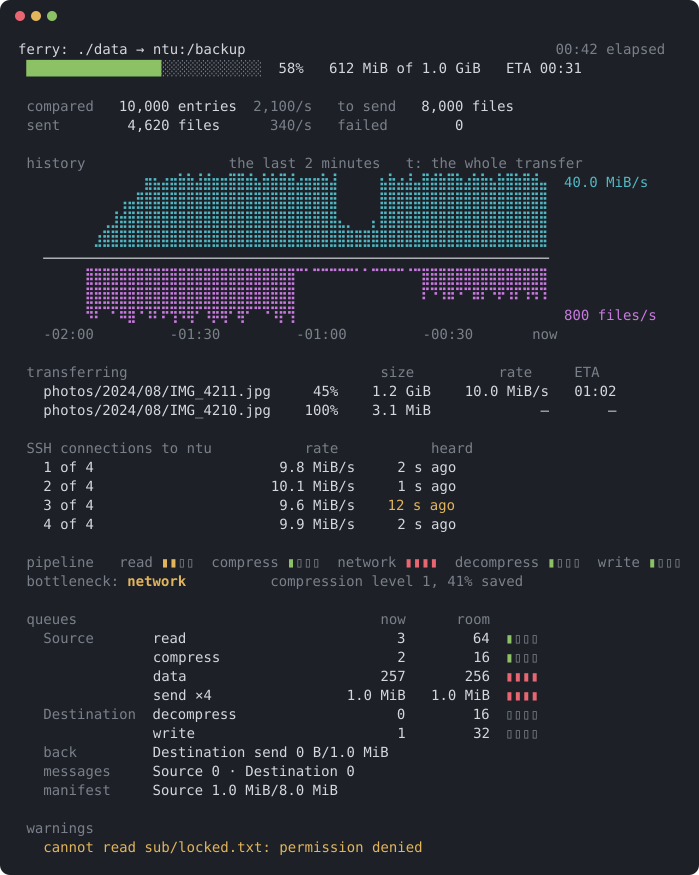

# Ferry 儀表板

[English](dashboard.md)

狀態：**草稿，討論中。** 每一節都標明它是已決定還是提議。[架構](architecture.zh-TW.md)說明顯示儀表板的 client，以及 server 傳給它的 report；[管線](pipeline.zh-TW.md)則說明它所顯示的 stage。

**已決定。** 傳輸在終端機上執行時，client 會顯示儀表板：一個就地更新的全螢幕畫面。它讓你追蹤傳輸，並找出拖慢傳輸的原因：進行到哪裡、每條 SSH connection 有多快，以及其他 stage 在等待管線中的哪一個 stage。

```text
ferry: ./data → ntu:/backup                                     00:42 elapsed
 ████████████████░░░░░░░░░░░░  58%   612 MiB of 1.0 GiB   ETA 00:31

 compared   10,000 entries  2,100/s   to send   8,000 files
 sent        4,620 files      340/s   failed        0

 history                 the last 2 minutes   t: the whole transfer
   ⠀⠀⠀⠀⠀⠀⠀⠀⠀⠀⠀⠀⣶⣦⣴⣶⣷⣷⣼⣾⣶⣶⣿⣿⣾⣦⣷⣷⣿⣾⣴⣶⣶⣷⣼⠀⠀⠀⠀⠀⣦⣷⣴⣼⣤⣿⣾⣷⣿⣷⣴⣷⣷⣦⣷⣿⣷⣿⣾⣤  40.0 MiB/s
   ⠀⠀⠀⠀⠀⠀⠀⠀⠀⢠⣤⣿⣿⣿⣿⣿⣿⣿⣿⣿⣿⣿⣿⣿⣿⣿⣿⣿⣿⣿⣿⣿⣿⣿⣿⠀⠀⠀⠀⠀⣿⣿⣿⣿⣿⣿⣿⣿⣿⣿⣿⣿⣿⣿⣿⣿⣿⣿⣿⣿
   ⠀⠀⠀⠀⠀⠀⠀⢀⣸⣾⣿⣿⣿⣿⣿⣿⣿⣿⣿⣿⣿⣿⣿⣿⣿⣿⣿⣿⣿⣿⣿⣿⣿⣿⣿⣄⡀⠀⠀⡄⣿⣿⣿⣿⣿⣿⣿⣿⣿⣿⣿⣿⣿⣿⣿⣿⣿⣿⣿⣿
   ⠀⠀⠀⠀⠀⠀⣰⣿⣿⣿⣿⣿⣿⣿⣿⣿⣿⣿⣿⣿⣿⣿⣿⣿⣿⣿⣿⣿⣿⣿⣿⣿⣿⣿⣿⣿⣿⣿⣿⣿⣿⣿⣿⣿⣿⣿⣿⣿⣿⣿⣿⣿⣿⣿⣿⣿⣿⣿⣿⣿
   ────────────────────────────────────────────────────────────
   ⠀⠀⠀⠀⠀⣿⣿⣿⣿⣿⣿⣿⣿⣿⣿⣿⣿⣿⣿⣿⣿⣿⣿⣿⣿⣿⣿⣿⣿⣿⠉⠁⠉⠉⠉⠉⠉⠁⠁⠉⠉⠉⠉⠈⠉⣿⣿⣿⣿⣿⣿⣿⣿⣿⣿⣿⣿⣿⣿⣿
   ⠀⠀⠀⠀⠀⣿⣿⣿⣿⣿⣿⣿⣿⣿⣿⣿⣿⣿⣿⣿⣿⣿⣿⣿⣿⣿⣿⣿⣿⣿⠀⠀⠀⠀⠀⠀⠀⠀⠀⠀⠀⠀⠀⠀⠀⠏⠙⠹⠿⠙⠉⠿⠏⠙⠟⠹⠏⠹⠻⠹
   ⠀⠀⠀⠀⠀⠻⠏⠉⠋⠿⣿⠙⠹⠏⠟⢻⠻⢿⠋⠹⡿⢿⠋⢿⠋⠉⠙⠹⡟⢻⠀⠀⠀⠀⠀⠀⠀⠀⠀⠀⠀⠀⠀⠀⠀⠀⠀⠀⠀⠀⠀⠀⠀⠀⠀⠀⠀⠀⠀⠀  800 files/s
   -02:00         -01:30         -01:00         -00:30       now

 transferring                              size          rate     ETA
   photos/2024/08/IMG_4211.jpg     45%    1.2 GiB    10.0 MiB/s   01:02
   photos/2024/08/IMG_4210.jpg    100%    3.1 MiB             —       —

 SSH connections to ntu           rate       heartbeat
   1 of 4                      9.8 MiB/s     2 s ago
   2 of 4                     10.1 MiB/s     1 s ago
   3 of 4                      9.6 MiB/s    12 s ago
   4 of 4                      9.9 MiB/s     2 s ago

 pipeline   read ▮▮▯▯  compress ▮▯▯▯  network ▮▮▮▮  decompress ▮▯▯▯  write ▮▯▯▯
 bottleneck: network          compression level 1, 41% saved

 queues                                 now   room
   Source       read                      3     64  ▮▯▯▯
                compress                  2     16  ▮▯▯▯
                data                    257    256  ▮▮▮▮
                send ×4                  34     32  ▮▮▮▮
   client       from Source             256    256  ▮▮▮▮
                to Destination ×4         9     32  ▮▯▯▯
   Destination  receive                   0    256  ▯▯▯▯
                decompress                0     16  ▯▯▯▯
                write                     1     32  ▯▯▯▯
   back         Destination send 0/32 · Source receive 0/256
   messages     Source 0 · Destination 0
   manifest     Source 1.0 MiB/8.0 MiB

 warnings and failures
   cannot read sub/locked.txt: permission denied
```

## 顯示內容

**已決定。**

- **整體傳輸**：進度條、已送出與待送出的位元組數、速率，以及剩餘時間。
- **計數**：已比較的項目、待送出的檔案、已送出的檔案，以及失敗的檔案；已比較的項目與已送出的檔案旁邊，附上過去 5 秒每秒的數量，讓有許多小檔案的目錄樹，在每秒位元組數說明不了什麼時，也看得出進度。
- **每條 SSH connection**：其速率，以及距上一次 [heartbeat](architecture.zh-TW.md#connection) 抵達已過多久，依 host 分組。本機上的位置沒有 SSH connection。
- **管線**：每個 stage 前的佇列有多滿，從讀取到寫入，以及哪個 stage 是瓶頸。
- **佇列**：依各側最近一秒的狀況，資料經過的佇列以表格呈現，依資料流動的順序，從 Source 經 client 到 Destination：每個佇列目前的量、上限，以及表示充滿程度的格子；一條 connection 的各條 path 合為一列，例如 `send ×4`。接著，回傳的 needs 與 results、訊息，以及 manifest 的佇列，各一行，只列有用到的。佇列是在東西放進去時計數的，所以顯示超過上限的佇列，表示有人正等著再放進去；見[效能剖析](profiling.zh-TW.md#邊傳輸邊追蹤)，每條 path 各自每一秒的數字則見 `--profile-file`。
- **警告與失敗**：最新的幾則，隨到隨顯示。
- **正在傳輸的檔案**，如同 rclone 的顯示：Destination 正在接收或寫入的每個檔案，以相對於目的地的路徑列出，附上已到達的比例、大小、速率與剩餘時間。最先開始的排在最前面，讓大檔案停在原處，小檔案來來去去；顯示前 6 個，其餘只列出數量。路徑太長、螢幕放不下時，中間會以 `…` 省略。與 rclone 平行傳送檔案不同，record stream 一次只帶來一個檔案的位元組：最常見的是一個檔案在前進，排在它前面、已經全部到達的檔案則在等各自的 writer。
- **歷史圖**，如同 nvitop 畫的那樣：每秒一欄 braille 點，預設是最近 2 分鐘，現在在最右邊；按 `t` 切換成整個傳輸期間，這時每欄是它所涵蓋的那幾秒的平均，再按一次切回來。軸線上方是進度條所計算的每秒位元組數；下方鏡像畫出每秒內容到達的檔案數，讓有許多小檔案、每秒位元組數說明不了什麼的目錄樹，也看得出進度。上下兩半各自依畫面內的最大值縮放。畫面較矮時，依[版面](#版面)的規則省略它。client 從它已有的計數記下每一秒到達了多少，connection 上不多傳任何東西。

## 版面

**已決定。** 每個區塊的高度只由畫面大小決定，與它的內容無關：同一個大小的畫面，從頭到尾都是同一個版面，只有數字在變。

| 區塊 | 行數 |
|---|---|
| 標題與進度條，加一個空行 | 3 |
| 計數，加一個空行 | 3 |
| 歷史圖：標題、軸線上方 4 行、軸線、下方 3 行、時間刻度，加一個空行 | 11 |
| 正在傳輸的檔案：標題、6 個檔案、`… and N more`，加一個空行 | 9 |
| 每個 host 的 SSH connection：標題、每條 connection 一行，加一個空行 | 2 + connection 數 |
| 管線與瓶頸，加一個空行 | 3 |
| 佇列：標題、9 個 stage、其後的 3 行，加一個空行 | 14 |
| 警告與失敗：標題，以及最新的 6 則 | 7 |

內容較少的區塊，空出的行留白：檔案不到 6 個、警告較少、還沒有歷史資料時都是如此。佇列從一開始就顯示，還沒到的數字顯示 `—`。一個 host 的 connection 數在儀表板開啟前就已知，所以它的區塊也不會變。

全部共 50 行；有一個 4 條 connection 的 host 時，如上面的例子，再加 6 行。畫面較矮時，只依畫面高度，依下列順序整塊省略區塊：

1. 佇列。
2. 管線。
3. 正在傳輸的檔案，減為 3 個。
4. 歷史圖。
5. 接著警告，最後是 connection，從底部減少行數。

有一個 4 條 connection 的 host 時，就是：56 行起顯示全部區塊；42 行起沒有佇列；39 行起也沒有管線；36 行起正在傳輸的檔案只剩 3 個；25 行起沒有歷史圖。沒有 host 時，每個門檻都少 6 行。

40 行時：

```text
 ferry: ./data → ntu:/backup                                     00:42 elapsed
 ████████████████░░░░░░░░░░░░  58%   612 MiB of 1.0 GiB   ETA 00:31

 compared   10,000 entries  2,100/s   to send   8,000 files
 sent        4,620 files      340/s   failed        0

 history                 the last 2 minutes   t: the whole transfer
   ⠀⠀⠀⠀⠀⠀⠀⠀⠀⠀⠀⠀⣶⣦⣴⣶⣷⣷⣼⣾⣶⣶⣿⣿⣾⣦⣷⣷⣿⣾⣴⣶⣶⣷⣼⠀⠀⠀⠀⠀⣦⣷⣴⣼⣤⣿⣾⣷⣿⣷⣴⣷⣷⣦⣷⣿⣷⣿⣾⣤  40.0 MiB/s
   ⠀⠀⠀⠀⠀⠀⠀⠀⠀⢠⣤⣿⣿⣿⣿⣿⣿⣿⣿⣿⣿⣿⣿⣿⣿⣿⣿⣿⣿⣿⣿⣿⣿⣿⣿⠀⠀⠀⠀⠀⣿⣿⣿⣿⣿⣿⣿⣿⣿⣿⣿⣿⣿⣿⣿⣿⣿⣿⣿⣿
   ⠀⠀⠀⠀⠀⠀⠀⢀⣸⣾⣿⣿⣿⣿⣿⣿⣿⣿⣿⣿⣿⣿⣿⣿⣿⣿⣿⣿⣿⣿⣿⣿⣿⣿⣿⣄⡀⠀⠀⡄⣿⣿⣿⣿⣿⣿⣿⣿⣿⣿⣿⣿⣿⣿⣿⣿⣿⣿⣿⣿
   ⠀⠀⠀⠀⠀⠀⣰⣿⣿⣿⣿⣿⣿⣿⣿⣿⣿⣿⣿⣿⣿⣿⣿⣿⣿⣿⣿⣿⣿⣿⣿⣿⣿⣿⣿⣿⣿⣿⣿⣿⣿⣿⣿⣿⣿⣿⣿⣿⣿⣿⣿⣿⣿⣿⣿⣿⣿⣿⣿⣿
   ────────────────────────────────────────────────────────────
   ⠀⠀⠀⠀⠀⣿⣿⣿⣿⣿⣿⣿⣿⣿⣿⣿⣿⣿⣿⣿⣿⣿⣿⣿⣿⣿⣿⣿⣿⣿⠉⠁⠉⠉⠉⠉⠉⠁⠁⠉⠉⠉⠉⠈⠉⣿⣿⣿⣿⣿⣿⣿⣿⣿⣿⣿⣿⣿⣿⣿
   ⠀⠀⠀⠀⠀⣿⣿⣿⣿⣿⣿⣿⣿⣿⣿⣿⣿⣿⣿⣿⣿⣿⣿⣿⣿⣿⣿⣿⣿⣿⠀⠀⠀⠀⠀⠀⠀⠀⠀⠀⠀⠀⠀⠀⠀⠏⠙⠹⠿⠙⠉⠿⠏⠙⠟⠹⠏⠹⠻⠹
   ⠀⠀⠀⠀⠀⠻⠏⠉⠋⠿⣿⠙⠹⠏⠟⢻⠻⢿⠋⠹⡿⢿⠋⢿⠋⠉⠙⠹⡟⢻⠀⠀⠀⠀⠀⠀⠀⠀⠀⠀⠀⠀⠀⠀⠀⠀⠀⠀⠀⠀⠀⠀⠀⠀⠀⠀⠀⠀⠀⠀  800 files/s
   -02:00         -01:30         -01:00         -00:30       now

 transferring                              size          rate     ETA
   photos/2024/08/IMG_4211.jpg     45%    1.2 GiB    10.0 MiB/s   01:02
   photos/2024/08/IMG_4210.jpg    100%    3.1 MiB             —       —
   photos/2024/08/IMG_4209.jpg    100%    2.9 MiB             —       —
   photos/2024/08/IMG_4208.jpg    100%    3.4 MiB             —       —
   photos/2024/08/IMG_4207.jpg    100%    3.0 MiB             —       —
   photos/2024/08/IMG_4206.jpg    100%    2.8 MiB             —       —
   … and 37 more

 SSH connections to ntu           rate       heartbeat
   1 of 4                      9.8 MiB/s     2 s ago
   2 of 4                     10.1 MiB/s     1 s ago
   3 of 4                      9.6 MiB/s    12 s ago
   4 of 4                      9.9 MiB/s     2 s ago

 warnings and failures
   cannot read sub/locked.txt: permission denied


```

30 行時，最下面 5 行留白：

```text
 ferry: ./data → ntu:/backup                                     00:42 elapsed
 ████████████████░░░░░░░░░░░░  58%   612 MiB of 1.0 GiB   ETA 00:31

 compared   10,000 entries  2,100/s   to send   8,000 files
 sent        4,620 files      340/s   failed        0

 transferring                              size          rate     ETA
   photos/2024/08/IMG_4211.jpg     45%    1.2 GiB    10.0 MiB/s   01:02
   photos/2024/08/IMG_4210.jpg    100%    3.1 MiB             —       —
   photos/2024/08/IMG_4209.jpg    100%    2.9 MiB             —       —
   … and 40 more

 SSH connections to ntu           rate       heartbeat
   1 of 4                      9.8 MiB/s     2 s ago
   2 of 4                     10.1 MiB/s     1 s ago
   3 of 4                      9.6 MiB/s    12 s ago
   4 of 4                      9.9 MiB/s     2 s ago

 warnings and failures
   cannot read sub/locked.txt: permission denied


```

## 顏色

**已決定。**



畫面大部分維持原樣：文字用終端機本身的顏色，說明數字是什麼的標籤是暗色。只有一眼就該看出什麼的地方才上色：

- **需要注意的東西**，像紅綠燈：每個佇列的格子，以及 pipeline 的格子，未滿一半綠色、到四分之三黃色、超過則紅色，讓資料堆在哪裡遠遠就看得出來；有瓶頸時，瓶頸黃色；heartbeat 漏了一次、超過 10 秒時黃色，超過 20 秒紅色，這時已接近 path 被切斷的 30 秒；警告與失敗黃色，失敗的檔案數一旦大於 0 則變紅。
- **區分兩種東西**：進度條綠色；歷史圖中，每秒位元組數青色、每秒檔案數洋紅色，刻度也用各自的顏色。
- **用終端機自己的顏色**，即 16 個具名色，不寫死色調：由主題決定實際的顏色，讓深色和淺色背景都看得清楚。
- **設定 `NO_COLOR` 時不上色**，依照慣例；暗色與粗體保留。

## 行為方式

**已決定。**

- **預設開啟。** 在標準錯誤輸出是終端機的地方，傳輸會顯示儀表板。`--no-ui` 則改為顯示進度列，就像有儀表板之前那樣。
- **擁有自己的全螢幕畫面。** 儀表板使用終端機的替代畫面。傳輸結束時，無論以何種方式結束，終端機都會恢復原狀，留下的是摘要列，接著是每則警告與失敗，寫到標準錯誤輸出，讓它們留在捲動紀錄中。
- **不會有任何東西印在它上面。** 傳輸期間原本會寫到標準錯誤輸出的警告與失敗，會顯示在儀表板中，並在它關閉時寫出。
- **dry run 也有儀表板。** 在進度條的位置，它顯示是什麼拖慢了執行：執行緒最忙的那一側，以及它在做什麼；在已送出與正在傳輸的檔案的位置，顯示列出了幾項，以及最近幾筆；不顯示 pipeline 與歷史圖，因為它不攜帶任何東西。它的清單一找到就寫到標準輸出，除非標準輸出就是儀表板所在的終端機：那時不寫出，以免成千上萬行把畫面洗掉，結束時說明共有幾項，並提示把標準輸出導向別處才能看到。`--no-ui` 則照舊把清單一找到就寫到終端機。清單被讀得很慢時，例如被分頁器讀取，會讓執行慢下來，而不是堆在記憶體中。清單與警告中的名稱，與標準輸出一樣經過處理：終端機會執行的位元組寫成 `\#` 加三位八進位數字。
- **不在終端機上時，照舊。** 在標準錯誤輸出不是終端機的地方，什麼都不顯示，或在使用 `--progress` 時每隔幾秒顯示一次進度列。
- **Ctrl-C 取消傳輸**，就和沒有儀表板時一樣。其他按鍵都不會，以免誤觸而取消；`t` 只切換歷史圖顯示的範圍。
- **它隨傳輸一起開始。** 每次登入都在準備期間、儀表板開啟之前完成，因此任何提示都不會出現在其中。

## 數字從何而來

**已決定。**

- **計數**來自 peer 的 report，與進度列相同。每秒的檔案數，在每個檔案的內容全部到達 Destination 時逐一計數，因為已送出的檔案數是以 rename 批次增加的，一次最多 256 個。
- **正在傳輸的檔案**來自 Destination：只要有這樣的檔案，它每秒回報一次每個已交給 writer、尚未完成的檔案，附上大小與已轉交給 writer 的位元組數；沒有時，它回報一次沒有。client 依據每個檔案過去 5 秒回報的位元組數，算出其速率。
- **管線的佇列**也來自 peer：每個 server 以一種新的 report 回報其佇列有多滿。Source 擁有讀取與壓縮之前的佇列，Destination 擁有解壓縮與寫入之前的佇列。
- **每條 SSH connection 的速率與 heartbeat** 來自 client 自己的 transport，它攜帶每條 path 與 heartbeat channel。
- 以 `ratatui` 搭配 `crossterm` 繪製。

- **進度條在內容抵達 Destination 時就計入**，不等其檔案完成，讓少數大檔案和許多小檔案一樣能推動進度條。待送出的位元組，是 Destination 比較後判定需要其內容的那些檔案的位元組。

**提議。**

- **每個 stage 前的佇列**：讀取是 Source 交給其讀取執行緒的檔案；壓縮與解壓縮是等待執行緒池的 frame；網路是 Source 等待 connection 的 data packet；寫入是 Destination 交給其寫入執行緒的檔案。每個 server 每秒回報四次其佇列。
- **瓶頸**是第一個在最近 3 秒平均下佇列至少四分之三滿、而其後一個 stage 的佇列並未如此的 stage；若直到最後一個的每個佇列都是滿的，則為最後一個。沒有任何佇列那麼滿時，就沒有瓶頸。
- **剩餘時間**是剩餘的位元組除以最近 5 秒的速率。
